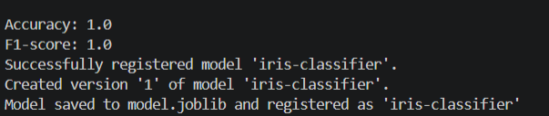
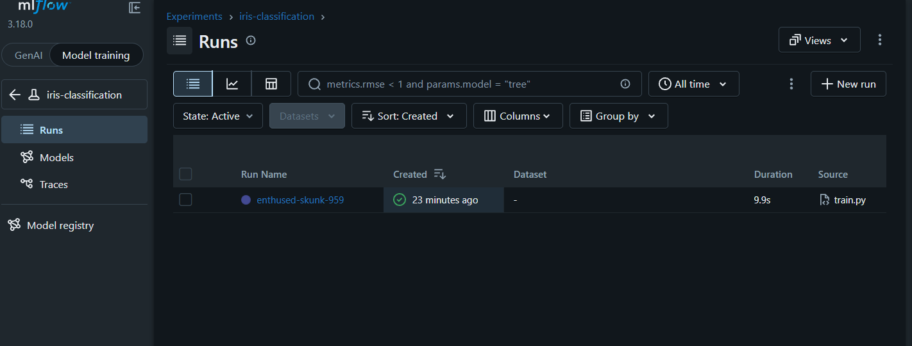
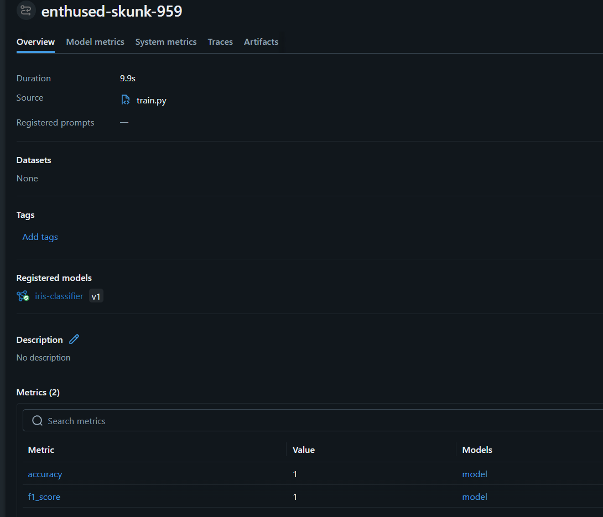
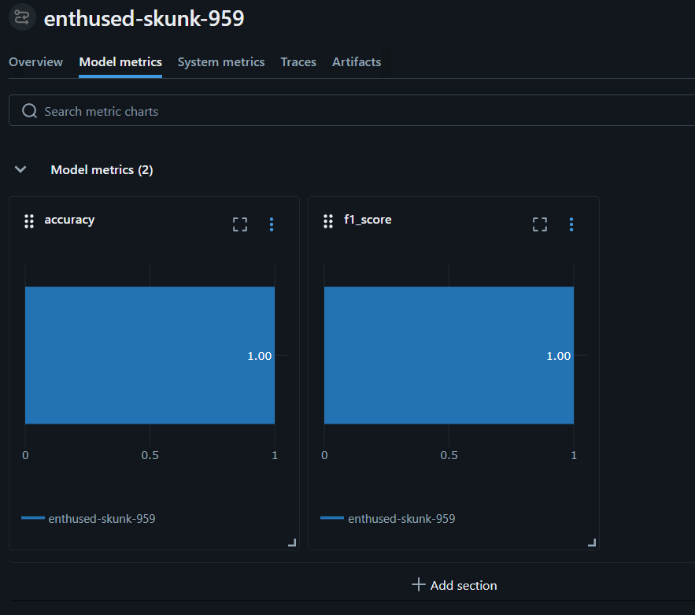
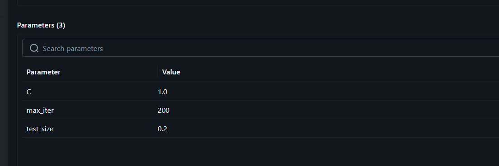
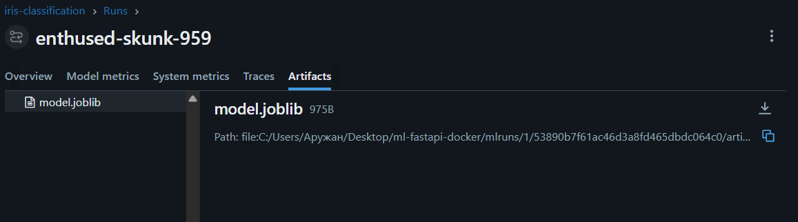
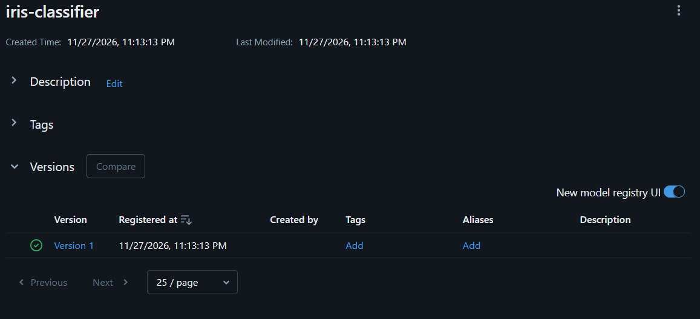
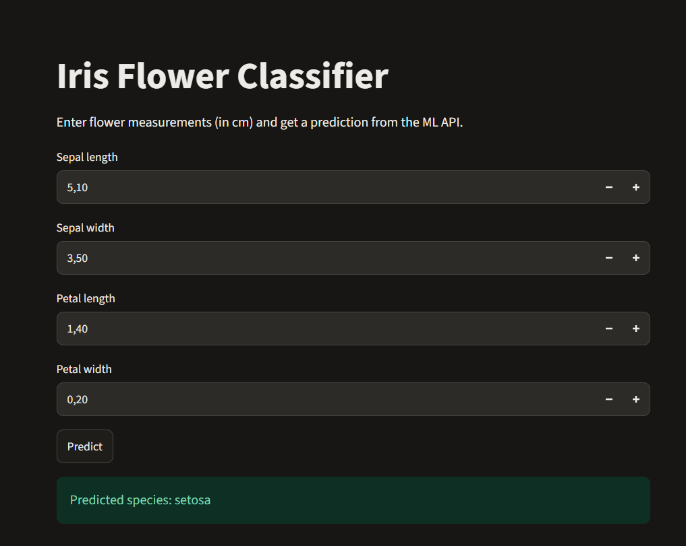
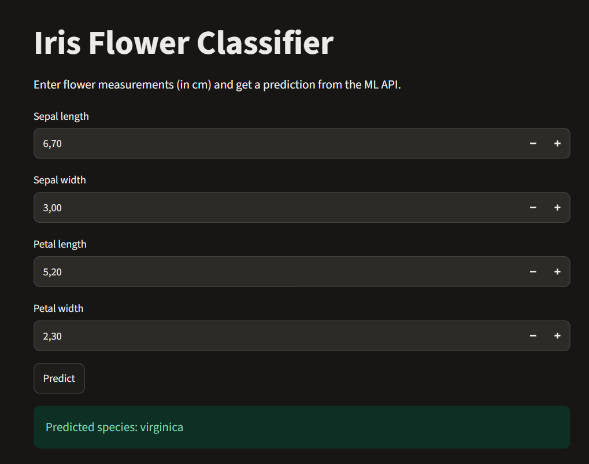
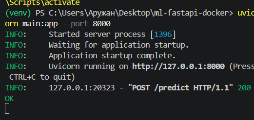

# Iris ML System: FastAPI + Docker + Streamlit + MLflow

A simple end-to-end ML system built on the Iris dataset:

- **Model**: Logistic Regression (scikit-learn)
- **Experiment tracking & Model Registry**: MLflow
- **Backend API**: FastAPI, containerized with Docker
- **Frontend**: Streamlit

## Architecture

```
            train.py
               │
     ┌─────────┴──────────┐
     ▼                    ▼
model.joblib        MLflow (mlflow.db + mlruns/)
     │               - params, metrics, artifacts
     ▼               - Model Registry: iris-classifier v1
FastAPI (main.py, Docker)
     ▲
     │  POST /predict (JSON)
     │
Streamlit UI (app.py)  ◄── user
```

1. `train.py` trains the model, logs parameters, metrics and artifacts to MLflow, registers the model in the MLflow Model Registry and saves `model.joblib`.
2. `main.py` (FastAPI) loads `model.joblib` and serves predictions.
3. `app.py` (Streamlit) gives the user a form, sends the input to the API and shows the result.

## Project structure

```
ml-fastapi-docker/
├── train.py              # training + MLflow tracking and registration
├── main.py               # FastAPI app
├── app.py                # Streamlit frontend
├── model.joblib          # saved model
├── requirements.txt      # API dependencies (used in Docker)
├── requirements-app.txt  # all dependencies (API + MLflow + Streamlit)
├── Dockerfile            # container for the API
└── README.md
```

## 1. Install dependencies

```bash
pip install -r requirements-app.txt
```

## 2. Train the model and log it to MLflow

```bash
python train.py
```

What is logged to the experiment `iris-classification`:

| Type | Values |
|---|---|
| Parameters | `C`, `max_iter`, `test_size` |
| Metrics | `accuracy`, `f1_score` (macro) |
| Artifacts | `model.joblib` (run artifact) |
| Logged model | `model` (MLflow sklearn model, linked to the run) |

The model is registered in the Model Registry as **`iris-classifier`**. Each new run of `train.py` creates a new version (1, 2, 3, ...).

## 3. Open the MLflow UI

```bash
mlflow ui --backend-store-uri sqlite:///mlflow.db --port 5000
```

Open http://localhost:5000:

- **Experiments → iris-classification**: runs with parameters and metrics
- **Models → iris-classifier**: registered model versions

## 4. Run the API

Locally:

```bash
uvicorn main:app --port 8000
```

Or with Docker:

```bash
docker build -t ml-fastapi .
docker run -p 8000:8000 ml-fastapi
```

- Root: http://localhost:8000/
- Swagger docs: http://localhost:8000/docs

## 5. Run the Streamlit frontend

In a second terminal (the API must be running):

```bash
streamlit run app.py
```

Open http://localhost:8501, enter the flower measurements and press **Predict**.

If the API runs on another address, set it with the `API_URL` environment variable:

```bash
API_URL=http://my-api:8000 streamlit run app.py
```

## API endpoints

**GET /**

```json
{"message": "ML API is running"}
```

**POST /predict**

Request:

```json
{
  "sepal_length": 5.1,
  "sepal_width": 3.5,
  "petal_length": 1.4,
  "petal_width": 0.2
}
```

Response:

```json
{"prediction": "setosa"}
```

## Screenshots

### Training with MLflow logging and registration


### MLflow experiment `iris-classification`


### Run details: metrics and registered model



### Logged parameters


### Logged artifact


### Model Registry: `iris-classifier`, version 1


### Streamlit frontend



### FastAPI receiving requests from Streamlit

